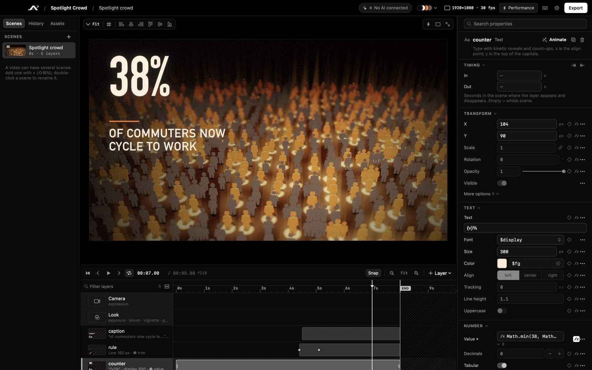
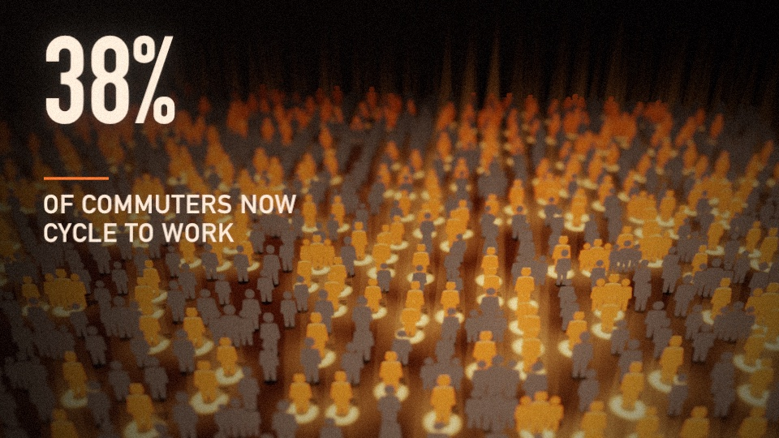
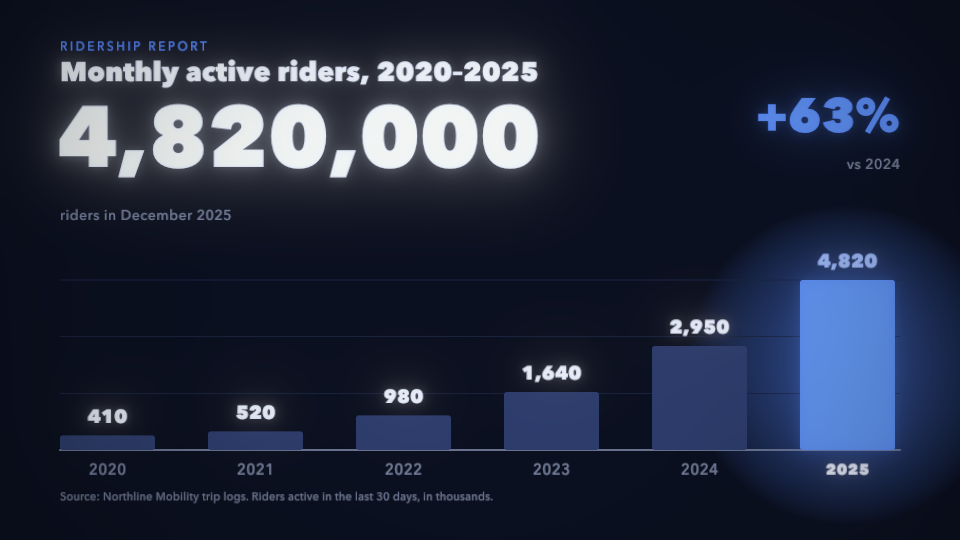
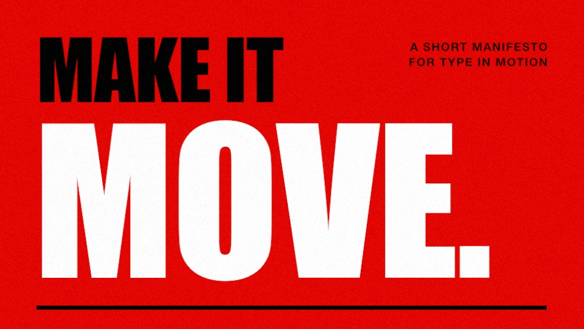
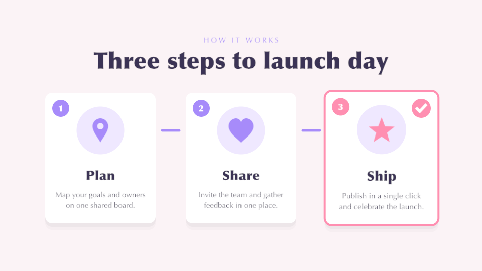
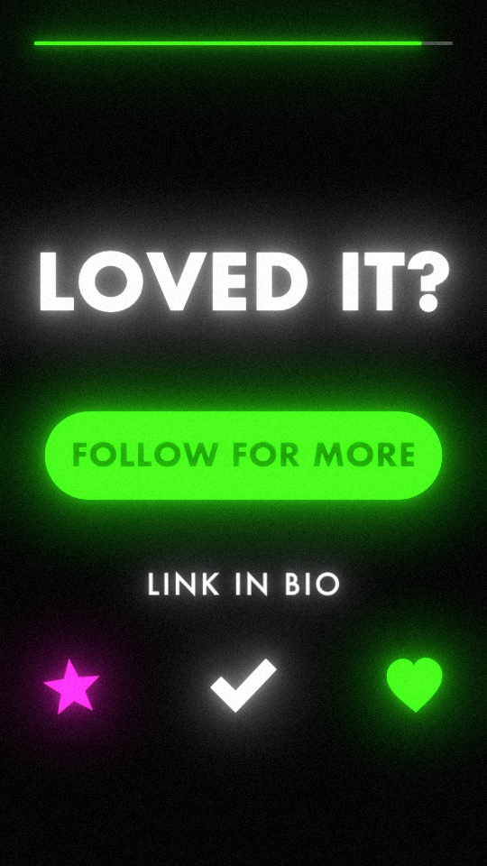
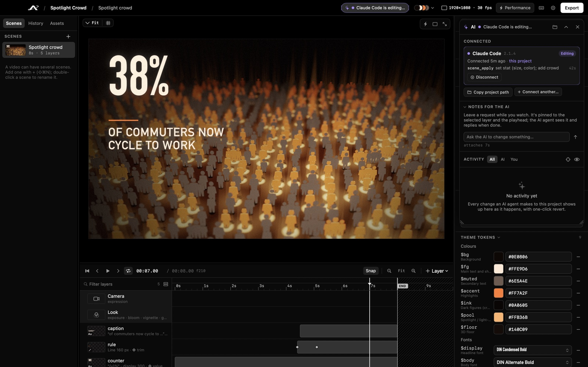
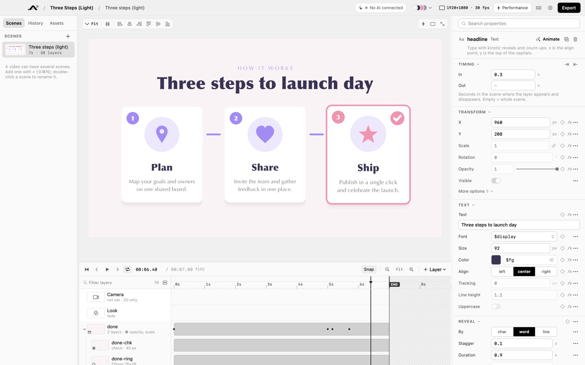

<p align="center"></p>

<h1 align="center">Arclight</h1>

<p align="center"><b>A native macOS motion-graphics editor, built to be driven by AI agents over MCP.</b></p>

<p align="center"></p>

Arclight is an editor and renderer for animated explainers, statistics, kinetic typography and 3D crowd
visuals. A scene is a small JSON file. An AI agent (Claude Code, Cursor, Codex or any other MCP client) builds and
edits scenes through Arclight's MCP server while you watch the changes appear in the editor, and you refine them by
hand with a timeline, keyframes and an inspector. Rendering is Metal; export is H.264, HEVC, ProRes 4444 with alpha or
a PNG sequence.

> **Alpha.** This is Arclight 0.1.0, the first public release. Expect rough edges. The project format may still
> change before 1.0; older projects keep loading. See the [changelog](CHANGELOG.md).

<p align="center"><br>
<sub>The <code>kinetic-type</code> example, rendered by Arclight itself.</sub></p>

## Who it's for

- People who make short videos with numbers, words and simple shapes (explainers, social clips, lower thirds,
  product stings) and want to describe the change they need instead of hunting through keyframes.
- People who already work with an AI coding agent and want it to produce video, not just code.
- Developers who want a scriptable renderer: projects are plain folders of JSON, and the `arclight` command line
  renders and exports them without opening a window.

Asking an AI to "make an animation" usually means it regenerates a whole program every time you want a change.
Arclight keeps the animation as structured data, so an agent changes only what you asked for ("make the number
bigger" is one small edit), and your look lives in reusable theme tokens, templates and symbol packs.

## Features

- **Editor**: Metal viewport, timeline with keyframes and markers, a layer list with thumbnails, an inspector
  generated from the engine's schema, undo, autosave, revision history with restore, a cinema viewer, and
  landscape, vertical or square canvases. Keyboard shortcuts follow DaVinci Resolve (J/K/L, I/O, and so on).
- **AI agents over MCP**: 28 tools to create projects and scenes, apply small atomic edits, preview frames, check a
  project for problems, make artwork (`symbol_save` for vector shapes, `asset_write` for images from SVG or PNG/JPEG
  data) and export. Every call shows up in the editor's AI panel with one-click revert, and you can leave notes for
  the agent pinned to a layer and a moment in time.
- **Layers**: text (per-character, word or line reveals, count-ups), shapes (gradients, lines that draw on),
  symbols (vector icons and logos), images, groups, repeaters (hundreds of symbols on a 3D floor: crowds, fields of
  icons) and lights.
- **Look**: perspective camera with depth of field and shake, fog, bloom, vignette, film grain, colour grading,
  motion blur and fades.
- **Animation**: keyframes with easing, JavaScript expressions (`wiggle`, `smoothstep`, live repeater statistics),
  markers, and reference audio with a waveform that is mixed into exports.
- **Design system**: theme tokens (`$fg`, `$accent`, `$display`, …), built-in theme presets, templates with
  parameters, and symbol packs made of SVG paths.
- **No dependencies**: Swift, Metal, AVFoundation and JavaScriptCore. Builds with the Command Line Tools; Xcode
  isn't needed.

## Examples

Eight example projects ship in [`Examples/`](Examples/README.md), each in a different style. These frames were
rendered from them by `Scripts/screenshots.sh`.

<table>
  <tr>
    <td width="50%"><br><sub><code>spotlight-crowd</code>: repeater, lights, fog, depth of field</sub></td>
    <td width="50%"><br><sub><code>data-bars</code>: count-ups and growing bars</sub></td>
  </tr>
  <tr>
    <td><br><sub><code>kinetic-type</code>: character, word and line reveals</sub></td>
    <td><br><sub><code>three-steps-light</code>: a light-theme explainer</sub></td>
  </tr>
</table>

<p align="center"><br>
<sub><code>social-vertical</code>: a 1080×1920 story clip</sub></p>

## How the AI workflow works

<p align="center"></p>

1. You connect your agent to Arclight once (see below). Each agent session runs its own `arclight mcp` server over
   stdio.
2. You ask for a video in plain words. The agent opens or creates a project, reads the built-in guide, and builds
   a scene with all its layers in one `scene_create` call.
3. It checks its work with `render_frames` (small preview images it can look at) and `project_check` (missing
   fonts, assets, symbols or theme tokens), then fixes things with small `scene_apply` operations.
4. If the project is open in the editor, every change appears live. The AI panel shows which agent is connected,
   what it is doing, and each change it made, with a revert button. You can keep editing by hand, or leave a note
   ("make the counter orange") for the agent to pick up.
5. The agent, or you, exports the video.

The editor and the agent never edit the same copy: both read and write the project folder, every save is a new
revision in the project's history, and stale writes are refused.

## Install

Requirements: macOS 14 or later on a Mac with Metal.

### Download the release

1. Download `Arclight-0.1.0.zip` from the [Releases page](https://github.com/xndrpr/arclight/releases), unzip it and
   move `Arclight.app` to `/Applications`.
2. **The app is ad-hoc signed and not notarized**, so macOS warns the first time you open it. Open it once and
   dismiss the warning. Then open **System Settings ▸ Privacy & Security**, scroll to *Security*, and click
   **Open Anyway** next to "Arclight was blocked". Confirm with your password or Touch ID. (On macOS 15 and later,
   right-click ▸ Open no longer skips this step.)
3. If macOS says the app "is damaged" or offers *Move to Trash*, click **Cancel** and run:

   ```bash
   xattr -cr /Applications/Arclight.app
   codesign --force --sign - /Applications/Arclight.app
   ```

### Or build and install it yourself

Apps you build yourself aren't quarantined, so macOS doesn't warn:

```bash
xcode-select --install            # Command Line Tools, if you don't have them
git clone https://github.com/xndrpr/arclight.git && cd arclight
Scripts/install.sh                # builds Arclight.app and installs it to /Applications
```

More detail, including what to do if the app disappears after an update: [docs/install.md](docs/install.md). The same
steps are in the app under **Help ▸ Install & Security Guide…**.

## Connect an AI agent

The app bundle contains the `arclight` command line, which also runs the MCP server:
`/Applications/Arclight.app/Contents/MacOS/arclight mcp` (stdio). Register it once, under the name `arclight`.

**Claude Code**:

```bash
claude mcp add -s user arclight -- /Applications/Arclight.app/Contents/MacOS/arclight mcp
```

**Cursor, Codex and other MCP clients**: add a stdio server with this command. Most clients take an
`mcpServers` entry like this one (for Cursor, in `~/.cursor/mcp.json`, or `.cursor/mcp.json` in a project):

```json
{
  "mcpServers": {
    "arclight": {
      "command": "/Applications/Arclight.app/Contents/MacOS/arclight",
      "args": ["mcp"]
    }
  }
}
```

Codex reads TOML from `~/.codex/config.toml`, or writes it for you with
`codex mcp add arclight -- /Applications/Arclight.app/Contents/MacOS/arclight mcp`:

```toml
[mcp_servers.arclight]
command = "/Applications/Arclight.app/Contents/MacOS/arclight"
args = ["mcp"]
```

You don't need to type these: when no agent is connected, the editor's AI panel has buttons that copy the Claude
Code command and the `mcpServers` entry with the right path for your copy of the app.

Then start a new agent session and ask, for example: *"Create an Arclight project at ~/Movies/Arclight/Launch.arclight
with a title card that says 'Launch day', then a 72% statistic with a crowd."* Open the project in Arclight to watch
it being built. To start the server on a particular project, pass `--project <path>` after `mcp`.

## A quick tour

<p align="center"></p>

- **Welcome window**: create a project, open one, or pick a recent one. New projects go to `~/Movies/Arclight` by
  default.
- **Left sidebar**: *Scenes* (a video can have several), *History* (every saved revision of the current scene, yours
  and the agent's; compare or restore any of them) and *Assets* (images, audio and fonts in the project).
- **Viewport**: the Metal preview, with move/scale/rotate handles, alignment tools and guides. Press **P** for the
  cinema viewer.
- **Timeline**: layers with their keyframes, markers, the work area and the audio waveform. Space plays,
  J/K/L shuttle, I/O set the in and out points.
- **Inspector**: every property of the selected layer, generated from the schema, with keyframe and expression
  buttons on each row. With nothing selected it shows the scene: camera, look (post effects) and theme tokens.
- **AI panel** (**⌥⌘A**): a floating panel with connected agents, notes for the agent, and the activity feed with
  revert.
- **Export** (**⌘E**): H.264 or HEVC MP4, ProRes 4444 with alpha, or a PNG sequence, with the scene's audio mixed in.

**Help ▸ Keyboard Shortcuts** (**?**) lists the rest. The editor comes in nine app themes (Dark, Light, Gruvbox,
Nord, Tokyo Night and others), separate from the theme of your video.

## Command line

The same binary is the app, the MCP server and a command-line renderer. From a source checkout, use
`swift run arclight …`; with the app installed, `/Applications/Arclight.app/Contents/MacOS/arclight …`.

```
arclight [open <project.arclight>]       open the editor
arclight render <project> [--scene ID] [--time S]... [--scale F] [--transparent] [--out FILE.png]
arclight export <project> [--scene ID]... [--format mp4|hevc|prores] [--scale F] [--fps N] [--out DIR]
arclight validate <project>              check every scene against the schema and expressions
arclight check <project>                 every problem project_check finds (fonts, assets, symbols, tokens)
arclight info <project>                  project and scene summary
arclight new <path.arclight> [--name N]  create an empty project
arclight docs [--out FILE.md]            print the scene format reference
arclight mcp [--project <project>]       run the MCP server on stdio
arclight --version
```

`arclight snapshot` (renders the editor UI off-screen to a PNG) and `arclight clickprobe` (replays clicks into
off-screen views) are development tools; see [CONTRIBUTING.md](CONTRIBUTING.md).

## Project format

A project is a folder with the `.arclight` extension:

```
Launch.arclight/
  project.json          name, canvas size, fps, theme tokens, scene order
  scenes/<id>.json      one scene per file: layers, keyframes, expressions, camera, look, audio
  assets/               images and audio
  fonts/                project fonts, registered automatically when the project opens
  symbols/*.json        project symbol packs
  templates/*.json      project templates
  exports/              rendered videos (default output folder)
  .history/             every saved revision of every scene
  .arclight/            the activity log (activity.jsonl) and notes for the agent (notes.json)
  .state.json           what the editor last showed (scene, selection, playhead), for the agent
```

Arclight was called Apogee before 0.1.0. Projects with the old `.apogee` extension still open in the app, the
command line and the MCP server; the first time, their hidden `.apogee/` folder is copied to `.arclight/`.

The full property reference is generated from the engine's schema: [docs/scene-format.md](docs/scene-format.md).

## Building from source

You need macOS 14 or later and the Swift 6.1 toolchain from the Command Line Tools (`xcode-select --install`).
Xcode is optional.

```bash
swift build                       # debug build
swift run arclight                # run the editor from the build folder
swift test                        # unit, render and editor-model tests
Scripts/bundle.sh                 # release build of dist/Arclight.app (ad-hoc signed)
Scripts/install.sh                # bundle.sh, then install to /Applications
```

Shaders are compiled at runtime, so no Metal toolchain is needed. [docs/architecture.md](docs/architecture.md) explains
how the code is organised.

## Contributing

Pull requests are welcome. [CONTRIBUTING.md](CONTRIBUTING.md) covers setup, the checks CI runs, the code
conventions, and how to add a layer type, an MCP tool, a panel or an example. Please follow the
[code of conduct](CODE_OF_CONDUCT.md), and report security problems privately as described in
[SECURITY.md](SECURITY.md).

## License

Arclight is free software under the [GNU General Public License v3.0](LICENSE). By opening a pull request, you agree
that your contribution is licensed under the same license.
